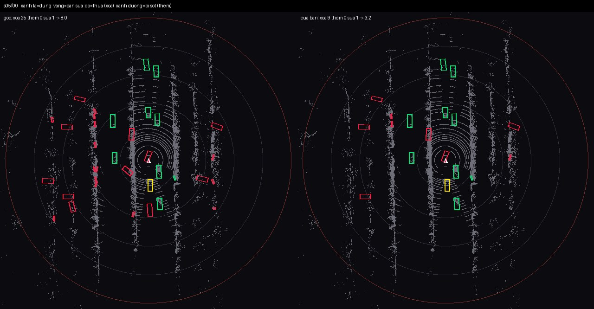

# Báo cáo Day 14 — Hồ Trung Kiên — 2A202603090

- Mã học viên dùng với `--student` là `2A202603090`.
- `seed_tag` trong `frames_A.txt` là `AC-_MUFc`.

## 1. Dự đoán trước sweep (bước 5b)

Ghi dự đoán cá nhân dựa trên ảnh BEV trong `d14_2A202603090/png_A/`, rồi commit và push mục này trước khi chạy `scripts/pp_sweep.py`. Giữ nguyên dự đoán sau khi có kết quả.

- **Tham số tôi dự đoán sẽ giảm công sửa nhiều nhất** — Tăng `score_thr` so với mức gốc `0.1` để lọc các hộp có độ tin cậy thấp.
- **Lý do** — Khi xem ảnh BEV của tập A, tôi thấy mô hình tạo nhiều hộp thừa, trong đó có hộp gán nhầm cho chính xe thu dữ liệu. Một vài hộp quanh xe thật cũng bị sai hướng. Tôi dự đoán tăng ngưỡng tin cậy sẽ lọc được một phần hộp thừa và giảm số hộp phải xóa khi sửa nhãn.

## 2. Tập A: sửa tay và tune

| Cấu hình | Xóa | Thêm | Sửa | Chi phí |
|---|---:|---:|---:|---:|
| Gốc | 56 | 1 | 3 | 19,3 |
| `best_config.json` | 19 | 8 | 2 | 14,7 |

Chi phí sửa được tính trong bán kính 50 m theo công thức `0,3 × xóa + 1,0 × thêm + 0,5 × sửa`. [Kết quả 24 cấu hình đã thử](../../d14_2A202603090/sweep.csv).

Nhãn tham chiếu tập A có 33 hộp trong phạm vi chấm. Tất cả ba frame đều có thay đổi so với pre-label gốc. Trên `s04f39`, phép chấm ghi nhận một hộp `Truck` bị sót cần thêm và hai hộp đã khớp cần chỉnh. [Nhãn tham chiếu tập A](../../d14_2A202603090/ref_A.json).

| Frame | Chi phí gốc | Chi phí với `best_config.json` |
|---|---:|---:|
| `s03f25` | 7,2 | 8,4 |
| `s04f39` | 4,1 | 3,1 |
| `s05f00` | 8,0 | 3,2 |

**Tham số thay đổi.** Cấu hình đã chọn tăng `score_thr` từ `0.1` lên `0.4`, giữ `min_points=0` và `range_m=50` như cấu hình gốc. [Cấu hình đã lưu](../../d14_2A202603090/best_config.json).

**Kết quả leave-one-out.** Mỗi lượt chọn cấu hình trên hai frame và chấm trên frame còn lại. Các dòng dưới đây được tính lại từ `sweep.csv` theo cách chọn của `scripts/pp_sweep.py`.

```text
s03f25: cấu hình chọn {'score_thr': '0.4', 'min_points': '0', 'range_m': '50'} → 8.4 (tốt nhất có thể 5.1)
s04f39: cấu hình chọn {'score_thr': '0.4', 'min_points': '0', 'range_m': '40'} → 5.1 (tốt nhất có thể 2.9)
s05f00: cấu hình chọn {'score_thr': '0.3', 'min_points': '10', 'range_m': '50'} → 5.6 (tốt nhất có thể 3.2)
```

Lượt chấm nào cũng chọn một tổ hợp khác nhau và chi phí đều cao hơn mức thấp nhất có thể trên frame được giữ lại. Trên cả tập A, cấu hình đã chọn đạt chi phí thấp nhất trong lưới đã thử (14,7), giảm 4,6 điểm chi phí so với cấu hình gốc. Riêng `s03f25`, chi phí tăng từ 7,2 lên 8,4.

## 3. Trước/sau (bước 8)



Trên `s05f00`, số hộp cần xóa giảm từ 25 xuống 9, số hộp cần thêm bằng 0 và số hộp cần sửa bằng 1 ở cả hai cấu hình. Chi phí của frame giảm từ 8,0 xuống 3,2. Hộp màu đỏ cần xóa, hộp màu vàng cần sửa và hộp màu xanh lá được giữ lại.

Trên cả ba frame A, `scripts/pp_compare.py` báo chi phí giảm từ 19,3 xuống 14,7, tương đương 23,8% (script làm tròn thành 24%). Số hộp cần xóa giảm từ 56 xuống 19, số hộp cần sửa giảm từ 3 xuống 2 và số hộp cần thêm tăng từ 1 lên 8. Bớt 37 lượt xóa giảm 11,1 điểm chi phí và bớt một lượt sửa giảm 0,5 điểm. Bảy lượt thêm phát sinh làm tăng 7,0 điểm, nên chi phí giảm ròng 4,6 điểm.

Dự đoán ở mục 1 đúng trên tập A. Tăng `score_thr` từ `0.1` lên `0.4` lọc được nhiều hộp thừa, và phần chi phí giảm nhờ bớt xóa và bớt sửa lớn hơn chi phí phát sinh do phải thêm hộp. Hiệu quả khác nhau giữa các frame. Chi phí trên `s03f25` vẫn tăng từ 7,2 lên 8,4.

## 4. Tập B

Dùng phép chấm của `scripts/pp_prelabel.py` để đối chiếu `pred_B.json` từ `best_config.json` với bản `ref_B.json` đã sửa. Trong bán kính 50 m, 128 trong 206 hộp dự đoán được ghép với 152 hộp tham chiếu trên 12 frame. Trên `s01f02`, hai hộp xe máy có người lái đã được đổi từ `Car` sang `Cyclist` sau khi đối chiếu ảnh camera.

| Xóa | Thêm | Sửa | Chi phí |
|---:|---:|---:|---:|
| 78 | 24 | 15 | 54,9 |

Lớp `Car` có chi phí sửa cao nhất (24,5 điểm), gồm 50 hộp cần xóa, 3 hộp cần thêm và 13 hộp cần sửa. Khi xét theo loại thao tác trên toàn tập B, thêm hộp chiếm 24,0 điểm, xóa hộp chiếm 23,4 điểm và sửa hộp chiếm 7,5 điểm. Frame `s01f02` có chi phí cao nhất (9,3 điểm), với 6 hộp cần xóa, 6 hộp cần thêm và 3 hộp cần sửa.

## 5. Giới hạn

- Tập A chỉ có ba frame. Mỗi lượt leave-one-out chọn tham số trên hai frame, và ba lượt cho ba tổ hợp khác nhau. Mức giảm chi phí trên tập A vì vậy chưa đủ để ước lượng mức cải thiện trên dữ liệu khác.
- Trọng số PointPillars huấn luyện trên KITTI chỉ nhận diện trực tiếp `Car`, `Cyclist` và `Pedestrian`. `Truck` và `Bus` được suy ra bằng quy tắc kích thước. Trên tập B, phép chấm vẫn ghi nhận 7 hộp `Bus` và 2 hộp `Truck` cần thêm.
- Chi phí sửa là điểm quy đổi theo trọng số của bài lab và chỉ xét hộp có tâm trong bán kính 50 m. Kết quả chưa cho biết thời gian thao tác trên CVAT.
- Phép rà nhãn dùng `scripts/vf_qa.py` để phát hiện kích thước bất thường, rồi đối chiếu các hộp được cảnh báo với ảnh camera. Kích thước và số điểm LiDAR chỉ là dấu hiệu để rà, nhất là khi vật thể bị che khuất.
